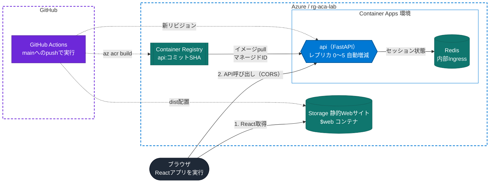

# Azureハンズオン：FastAPIコンテナ＋React静的ホスティング＋CI/CD＋オートスケール

Nov 19, 2026 · @Tatsuro

## ゴールと全体像

5つのLabで、FastAPIをAzure Container Appsで動かし、ReactをStorageの静的Webサイトで配信し、GitHub Actionsで自動デプロイし、負荷でレプリカが増える様子を見て、最後にセッション状態をRedisへ出してステートレスにします。1 Lab = 45〜60分の想定で、Labごとに区切って進められます。



ブラウザはStorageからReactを受け取り、そのReactがContainer AppsのAPIを直接呼びます。GitHub Actionsはイメージのビルドと `dist` の配置を行い、APIの状態はRedisに置きます（Lab 5で追加）。

| Lab | やること | 身につくこと |
| --- | --- | --- |
| 1 | FastAPIをコンテナ化してContainer Appsへ | ACR、Container Apps環境、Ingress、マネージドIDでのイメージPull |
| 2 | ReactをStorage静的Webサイトへ | `$web`コンテナ、CORS、データプレーンRBAC |
| 3 | GitHub ActionsでCI/CD | OIDC（フェデレーション資格情報）でのシークレットレス認証 |
| 4 | 負荷をかけてスケールアウト | HTTPスケールルール、レプリカ、スケールイン |
| 5 | ステートレス化 | スティッキーセッションの限界、外部ストア（Redis） |

AWSとの対応はこうなります。

| Azure | AWSで近いもの | このLabでの役割 |
| --- | --- | --- |
| Container Apps | ECS Fargate / App Runner | FastAPIの実行とオートスケール |
| Container Registry (ACR) | ECR | イメージ置き場とビルド |
| Storage 静的Webサイト | S3 静的ホスティング | Reactのビルド成果物の配信 |
| Entra ID フェデレーション資格情報 | IAM OIDCロール | GitHub Actionsからの認証 |
| Log Analytics | CloudWatch Logs | コンテナログ |
| Azure Managed Redis | ElastiCache | セッションの外部ストア（発展課題） |

注意：コマンドはこの教材用に書き下ろしたもので、実環境での通し実行はしていません。Azure CLIのバージョンでオプション名が変わることがあるので、エラーが出たら `az <command> --help` を確認してください。

## 事前準備

必要なのはAzureサブスクリプション、GitHubアカウント、Azure CLI、Docker、[Bun](https://bun.sh/) 1.2以上、[uv](https://docs.astral.sh/uv/)、[Task](https://taskfile.dev/) の7つです。Python 3.12 は uv が用意するので、別に入れなくて構いません。

リポジトリは1つで、`api/` と `web/` を並べます。Pythonの依存と設定はルートの `pyproject.toml` にまとめます。

```text
aca-lab/
  api/
    main.py           # FastAPI
    Dockerfile
  web/                # React (Vite)。Lab 2で作る
  .github/workflows/deploy.yml   # Lab 3で書く
  pyproject.toml      # Pythonの依存と、Ruff・Pyrightの設定
  uv.lock             # 依存のバージョンを固定したもの（uvが作る）
  .python-version     # 使うPythonのバージョン（3.12）
  .dockerignore       # コンテナのビルドに送らないファイル
  Taskfile.yml        # よく使うコマンドのまとめ
```

Pythonのプロジェクトを作り、依存を入れます。

```bash
uv init --python 3.12               # pyproject.toml と .python-version ができる
uv add fastapi "uvicorn[standard]"  # アプリの依存
uv add --dev ruff pyright           # 開発中だけ使う道具（コンテナには入らない）
```

`uv add` すると `uv.lock` が更新され、手元とコンテナで同じバージョンが入ります。Ruff（Lint・フォーマット）と Pyright（型チェック）の設定は `pyproject.toml` の `[tool.ruff]` と `[tool.pyright]` に書いてあります。

よく使うコマンドは `Taskfile.yml` にまとめてあり、`task --list` で一覧が出ます。

| コマンド | やること |
| --- | --- |
| `task run:api` | FastAPIを手元で起動する（保存すると自動で再起動） |
| `task build:api` | APIのコンテナイメージ `api:local` をビルドする |
| `task lint` | Lint・フォーマット・型をチェックする（ファイルは変えない） |
| `task fmt` | 自動で直せる指摘を直し、フォーマットを整える |

共通の変数とリソースグループを作ります。以降のLabはこの変数を使うので、ターミナルを開き直したら再度実行してください（`ACR` と `SA` は初回に決めた値を固定で入れ直す）。

```bash
az login
az extension add --name containerapp --upgrade
az provider register --namespace Microsoft.App
az provider register --namespace Microsoft.OperationalInsights
az provider register --namespace Microsoft.ContainerRegistry
az provider register --namespace Microsoft.Storage

RG=rg-aca-lab
LOC=japaneast
ENV=cae-aca-lab
ACR=acalab$RANDOM      # 全世界で一意、英小文字と数字のみ
SA=stacalab$RANDOM     # 同上
echo $ACR $SA          # 値を控えておく

az group create -n $RG -l $LOC
```

リソースをすべて1つのリソースグループに入れるのがポイントです。最後に `az group delete` 一発で全部消せます。

`az provider register` は、サブスクリプションでそのサービスを使えるようにする手続きで、最初の1回だけ必要です。登録には数分かかります。済む前にリソースを作ると `MissingSubscriptionRegistration` エラーになるので、次のコマンドで4つとも `Registered` になったのを確かめてから進めます。

```bash
for ns in Microsoft.App Microsoft.OperationalInsights Microsoft.ContainerRegistry Microsoft.Storage; do
  echo "$ns $(az provider show -n $ns --query registrationState -o tsv)"
done
```

## Lab 1：FastAPIをコンテナ化してContainer Appsで動かす

ゴールは、インターネットから `https://<アプリ>.<リージョン>.azurecontainerapps.io/api/whoami` を叩いてレプリカ名が返ることです。

### 1. アプリを書く

エンドポイントは4つ。`healthz` は死活確認用、`whoami` はどのレプリカが応答したかの確認用、`work` はLab 4の負荷用、`counter` はLab 5で直す「状態を持ってしまっているAPI」です。

`api/main.py`

```python
import asyncio
import os
import socket
import time
from collections import defaultdict
from typing import Annotated

from fastapi import FastAPI, Header
from fastapi.middleware.cors import CORSMiddleware

app = FastAPI()
app.add_middleware(
    CORSMiddleware,
    allow_origins=os.getenv("ALLOWED_ORIGINS", "*").split(","),
    allow_methods=["*"],
    allow_headers=["*"],
)

# Container Appsがレプリカごとに入れてくれる環境変数
REPLICA = os.getenv("CONTAINER_APP_REPLICA_NAME", socket.gethostname())

# プロセス内メモリに状態を持つ（Lab 5でこれが問題になる）
counts: dict[str, int] = defaultdict(int)

# アプリケーションの起動時刻を記録
STARTED_AT = time.monotonic()


@app.get("/healthz")
async def healthz():
    return {
        "status": "ok",
        "uptime": time.monotonic() - STARTED_AT,
    }


@app.get("/api/whoami")
async def whoami():
    return {"replica": REPLICA}


@app.get("/api/work")
async def work():
    await asyncio.sleep(0.5)  # 重い処理のつもり
    return {"replica": REPLICA}


@app.post("/api/counter")
async def counter(x_session_id: Annotated[str, Header()]):
    counts[x_session_id] += 1
    return {"count": counts[x_session_id], "replica": REPLICA}
```

`uptime` は `time.monotonic()` の差で測ります。`time.monotonic()` の値そのものはOSが起動してからの秒数なので、起動時刻を覚えておいて引き算します。

ヘッダーの受け取りは `Annotated[str, Header()]` と書きます。FastAPIが今すすめている書き方で、古い `x_session_id: str = Header()` だと Ruff が FAST002 で指摘します。

まずはコンテナを使わずに起動して確認します。

```bash
task run:api                      # = cd api && uv run uvicorn main:app --reload --port 8000
curl localhost:8000/api/whoami    # 別のターミナルで
task lint                         # Lint・型チェックも通しておく
```

### 2. コンテナにする

`api/Dockerfile`

```dockerfile
FROM python:3.12-slim
COPY --from=ghcr.io/astral-sh/uv:0.11.29 /uv /uvx /bin/

# アプリ専用の一般ユーザーを作る（UIDは数字で指定できるよう固定）
RUN groupadd --system --gid 10001 app \
 && useradd --system --uid 10001 --gid app --no-create-home app

WORKDIR /app
ENV UV_COMPILE_BYTECODE=1
# イメージに入っているPythonを使う。
ENV UV_PYTHON_DOWNLOADS=never

# 依存だけ先に入れる
# （main.py を変えても、このレイヤーはキャッシュが効く）
COPY pyproject.toml uv.lock ./
RUN uv sync --locked --no-dev --no-install-project --no-cache

COPY api/main.py .
ENV PATH="/app/.venv/bin:$PATH"

# 実行時は一般ユーザーで動かす。
# ファイルの持ち主は root のままなので、アプリからはコードも依存も書き換えられない
USER 10001:10001
CMD ["uvicorn", "main:app", "--host", "0.0.0.0", "--port", "8000"]
```

ポイントは3つです。

- **依存は `uv.lock` から入れる**: `uv sync --locked` は `uv.lock` と同じバージョンを入れ、`pyproject.toml` と食い違っていればエラーにします。`--no-dev` で Ruff や Pyright は入りません。
- **一般ユーザーで動かす**: ベースイメージのままだと root で動きます。アプリに脆弱性があったときの被害を小さくするため、`USER` で一般ユーザーに切り替えます。`pip install` や `uv sync` には root が要るので、切り替えは最後です。
- **`UV_PYTHON_DOWNLOADS=never`**: uv が別のPythonをダウンロードすると `/root` の下に置かれ、一般ユーザーからは読めなくなります。イメージに入っているPythonを使わせるための設定です。

Dockerfile は `api/` にありますが、`pyproject.toml` と `uv.lock` はルートにあるので、ビルドはルートから行います。ルートには `.dockerignore` を置いて、イメージに要るファイルだけをビルドに送ります。

`.dockerignore`

```text
# いったん全部をビルドに送らないようにして、イメージに必要なものだけ戻す。
# .venv や web/node_modules、.env などをうっかり送らずに済む
*

# 依存（uv sync で使う）
!pyproject.toml
!uv.lock

# API のコード（Dockerfile もここにある）
!api/
api/__pycache__/
```

これがないと、`.venv`（100MB前後）などもビルドのたびに送られます。`az acr build` では毎回Azureにアップロードされるので、遅くなります。

ローカルでビルドして確認します。

```bash
task build:api                     # = docker build -f api/Dockerfile -t api:local .
docker run --rm -p 8000:8000 api:local
curl localhost:8000/api/whoami     # 別のターミナルで
docker run --rm api:local id       # uid=10001(app) なら一般ユーザーで動いている
```

`docker build` の `-f` は使う Dockerfile、最後の `.` は `COPY` できるファイルの範囲（ビルドコンテキスト）です。`-f` を省くと、Docker は `.` の直下で `Dockerfile` を探して失敗します。

### 3. ACRを作ってイメージをビルドする

`az acr build` はビルドをACR側で実行するので、手元のCPUアーキテクチャ（Apple Siliconなど）を気にせず済みます。`-f` と最後の `.` の意味はローカルの `docker build` と同じです。

```bash
az acr create -n $ACR -g $RG --sku Basic
az acr build -r $ACR -t api:v1 -f api/Dockerfile .
```

`-r $ACR` で送り先を指定しているので、`-t` はACRの中での名前（`api:v1`）だけで足ります。ビルドが終わると、そのままACRに保存されます。

無料クレジットのサブスクリプションでは `az acr build` が拒否されることがあります。その場合はローカルでビルドしてpushします。

```bash
az acr login -n $ACR
task build:api -- --platform linux/amd64 -t $ACR.azurecr.io/api:v1
docker push $ACR.azurecr.io/api:v1
```

ローカルでビルドするときは、オプションが2つ増えます。

- **`--platform linux/amd64`**: Container Apps が動かすのは `linux/amd64` のイメージです。Apple Silicon の Mac では何もしないと `arm64` のイメージになり、Azure で起動できません。Windows（WSL）や Intel の Mac はもともと amd64 なので、付けても結果は同じです。
- **`-t $ACR.azurecr.io/api:v1`**: `docker push` はイメージ名の先頭のホスト名を送り先にします。`api:v1` のままだと Docker Hub に送ろうとするので、ACRのアドレスから始まる名前を付けます。

`task build:api -- ...` の `--` 以降は `docker build` にそのまま渡ります。最後の `.` はタスクの中で付けているので、自分では付けません。`$ACR` が空だと名前が不正になって失敗するので、先に `echo $ACR` で確かめてください。

### 4. Container Appsにデプロイする

環境（Environment）は複数アプリが共有するネットワークとログの境界で、ECSのクラスターに近いものです。

```bash
az containerapp env create -n $ENV -g $RG -l $LOC

az containerapp create -n api -g $RG --environment $ENV \
  --image $ACR.azurecr.io/api:v1 \
  --registry-server $ACR.azurecr.io --registry-identity system \
  --target-port 8000 --ingress external \
  --min-replicas 0 --max-replicas 5

FQDN=$(az containerapp show -n api -g $RG \
  --query properties.configuration.ingress.fqdn -o tsv)
curl https://$FQDN/api/whoami
```

`--registry-identity system` で、アプリのマネージドIDにACRのPull権限が付きます。パスワードをどこにも置かないのがAzure流です。

### 5. 自分のIPからだけアクセスできるようにする

このままだと、URLを知っていれば誰でもAPIを叩けます。Ingress のIP制限で、作業している回線からだけ届くようにします。`az containerapp create` にはIP制限のオプションがないので、作成のあとに設定します。

```bash
MY_IP=$(curl -4 -s https://ifconfig.me)   # このマシンのグローバルIP（IPv4）
echo $MY_IP

az containerapp ingress access-restriction set -n api -g $RG \
  --rule-name allow-my-ip \
  --ip-address $MY_IP/32 \
  --action Allow \
  --description "作業マシン"

az containerapp ingress access-restriction list -n api -g $RG -o table
```

- **`--action Allow`**: 許可のルールが1つでもあると、それ以外のIPからは全部拒否され、403が返ります。許可と拒否のルールは混ぜられません。
- **`/32`**: そのIPアドレス1つだけ、という意味です。
- **許可されるのは同じ回線の全員です**: 外からは家のルーターのIP1つに見えるので、同じWi-Fiのスマホなども通ります。
- **IPが変わると急に403になります**: ルーターの再起動などでグローバルIPが変わったら、同じルール名でもう一度 `set` すると上書きされます。

作成から制限までの数十秒は誰でもアクセスできますが、このAPIは秘密を持っていないので問題ありません。後のLabへの影響はほぼありません。Lab 2のReactはこのマシンのブラウザからAPIを呼び、Lab 3のデプロイはIngressを通らず、Lab 4の負荷も手元から打つからです。外す場合は次のコマンドです。

```bash
az containerapp ingress access-restriction remove -n api -g $RG --rule-name allow-my-ip
```

### 確認ポイント

- [ ] `whoami` がレプリカ名を返す
- [ ] `curl https://$FQDN/healthz` で `uptime` が起動からの秒数になっている
- [ ] スマホのWi-Fiを切ってモバイル回線から `https://$FQDN/api/whoami` を開くと、403になる
- [ ] `az containerapp replica list -n api -g $RG -o table` でレプリカが見える
- [ ] `az containerapp logs show -n api -g $RG --follow` でuvicornのログが流れる
- [ ] 数分放置するとレプリカが0になり、次のリクエストが少し遅い（コールドスタート）ことを体感する

## Lab 2：ReactをStorageの静的Webサイトにデプロイする

S3の静的ホスティングに当たるのが、ストレージアカウントの「静的Webサイト」機能です。有効にすると `$web` という特別なコンテナができ、そこに置いたファイルが `https://<アカウント>.z11.web.core.windows.net` のようなURLで配信されます。

AzureにはビルドとCDNまで面倒を見るStatic Web Appsもあり、実務ではそちらが定番です。ここでは仕組みが見えるStorage版を使い、Static Web Appsは発展課題に回します。

### 1. Reactアプリを作る

```bash
bun create vite web --template react-ts
cd web && bun install
```

`bun install` で `web/bun.lock` ができます。Lab 3のCIはこれを見て同じバージョンを入れるので、コミットしておきます。Node.jsは入れなくて構いません。`package.json` のスクリプト（`vite` など）は、Node.jsがなければBunが代わりに動かします。

`web/src/App.tsx` を置き換えます。セッションIDを `localStorage` に持ち、ボタンを押すたびに `counter` を叩いて、カウントと応答したレプリカ名を並べます。

```tsx
import { useState } from "react";

const API = import.meta.env.VITE_API_URL;

function sessionId(): string {
  let id = localStorage.getItem("sid");
  if (!id) {
    id = crypto.randomUUID();
    localStorage.setItem("sid", id);
  }
  return id;
}

export default function App() {
  const [log, setLog] = useState<string[]>([]);

  const hit = async () => {
    const res = await fetch(`${API}/api/counter`, {
      method: "POST",
      headers: { "X-Session-Id": sessionId() },
    });
    const { count, replica } = await res.json();
    setLog((l) => [`count=${count}  (${replica})`, ...l]);
  };

  return (
    <main>
      <h1>ACA Lab</h1>
      <button onClick={hit}>+1</button>
      <ul>
        {log.map((line, i) => (
          <li key={i}>{line}</li>
        ))}
      </ul>
    </main>
  );
}
```

ビルド時にAPIのURLを埋め込みます。

```bash
VITE_API_URL=https://$FQDN bun run build   # dist/ ができる
cd ..
```

### 2. ストレージを作ってアップロードする

```bash
az storage account create -n $SA -g $RG -l $LOC --sku Standard_LRS --kind StorageV2

# 自分にBlobのデータ操作権限を付ける（反映に1〜2分かかる）
az role assignment create \
  --assignee $(az ad signed-in-user show --query id -o tsv) \
  --role "Storage Blob Data Contributor" \
  --scope $(az storage account show -n $SA -g $RG --query id -o tsv)

az storage blob service-properties update --account-name $SA --auth-mode login \
  --static-website --index-document index.html --404-document index.html

az storage blob upload-batch --account-name $SA --auth-mode login \
  -s ./web/dist -d '$web' --overwrite

WEB_URL=$(az storage account show -n $SA -g $RG --query primaryEndpoints.web -o tsv)
echo $WEB_URL
```

ここでAWSと違うのが権限の考え方です。サブスクリプションの所有者でも、Blobの中身を読み書きするには「データプレーン」のロールが別途必要です。AZ-104 / AZ-305でもよく問われます。

### 3. CORSを絞る

Lab 1では全オリジン許可でした。フロントのURLだけに絞ります（末尾の `/` は外す）。

```bash
az containerapp update -n api -g $RG --set-env-vars ALLOWED_ORIGINS=${WEB_URL%/}
```

### 確認ポイント

- [ ] `$WEB_URL` をブラウザで開くとReactが表示される
- [ ] ボタンを押すと count が増え、レプリカ名が出る
- [ ] 開発者ツールのNetworkタブで、POSTの前にOPTIONS（プリフライト）が飛んでいるのを見る
- [ ] `az containerapp update` のたびに新しいリビジョンができることを `az containerapp revision list -n api -g $RG -o table` で確認する

## Lab 3：GitHub ActionsでCI/CDを組む

ゴールは、`main` にpushするとAPIとフロントが自動でデプロイされることです。認証はシークレットキーを使わず、OIDCでGitHubが発行する短命トークンをEntra IDが信頼する形にします。AWSのIAM OIDCロールと同じ発想です。

### 1. GitHub Actions用のIDを作る

```bash
SUB=$(az account show --query id -o tsv)
TENANT=$(az account show --query tenantId -o tsv)
REPO=<GitHubユーザー名>/aca-lab

APP_ID=$(az ad app create --display-name gh-aca-lab --query appId -o tsv)
az ad sp create --id $APP_ID

# リソースグループ内の操作権限
az role assignment create --assignee $APP_ID --role Contributor \
  --scope /subscriptions/$SUB/resourceGroups/$RG

# Blobアップロード用のデータプレーン権限
az role assignment create --assignee $APP_ID --role "Storage Blob Data Contributor" \
  --scope $(az storage account show -n $SA -g $RG --query id -o tsv)

# 「このリポジトリのmainブランチから来たトークンだけ信頼する」
az ad app federated-credential create --id $APP_ID --parameters '{
  "name": "gh-main",
  "issuer": "https://token.actions.githubusercontent.com",
  "subject": "repo:'$REPO':ref:refs/heads/main",
  "audiences": ["api://AzureADTokenExchange"]
}'
```

GitHub側にはIDを3つ登録します。どれも秘密情報ではなく、漏れてもそれだけではログインできません。

```bash
gh secret set AZURE_CLIENT_ID --body $APP_ID
gh secret set AZURE_TENANT_ID --body $TENANT
gh secret set AZURE_SUBSCRIPTION_ID --body $SUB
```

### 2. ワークフローを書く

`.github/workflows/deploy.yml`（`env` の4つは自分の値に置き換える）

```yaml
name: deploy

on:
  push:
    branches: [main]

permissions:
  id-token: write   # OIDCトークンの発行に必要
  contents: read

env:
  RG: rg-aca-lab
  ACR: <ACR名>
  SA: <ストレージアカウント名>
  API_URL: https://<FQDN>

jobs:
  api:
    runs-on: ubuntu-latest
    steps:
      - uses: actions/checkout@v4
      - uses: azure/login@v2
        with:
          client-id: ${{ secrets.AZURE_CLIENT_ID }}
          tenant-id: ${{ secrets.AZURE_TENANT_ID }}
          subscription-id: ${{ secrets.AZURE_SUBSCRIPTION_ID }}
      - name: Build image in ACR
        run: az acr build -r $ACR -t api:${{ github.sha }} -f api/Dockerfile .
      - name: Deploy new revision
        run: |
          az extension add --name containerapp --upgrade
          az containerapp update -n api -g $RG \
            --image $ACR.azurecr.io/api:${{ github.sha }}

  web:
    runs-on: ubuntu-latest
    steps:
      - uses: actions/checkout@v4
      - uses: oven-sh/setup-bun@v2
      - name: Build
        working-directory: web
        # --frozen-lockfile は npm ci 相当。bun.lock と package.json が食い違うと失敗する
        run: bun install --frozen-lockfile && bun run build
        env:
          VITE_API_URL: ${{ env.API_URL }}
      - uses: azure/login@v2
        with:
          client-id: ${{ secrets.AZURE_CLIENT_ID }}
          tenant-id: ${{ secrets.AZURE_TENANT_ID }}
          subscription-id: ${{ secrets.AZURE_SUBSCRIPTION_ID }}
      - name: Upload to $web
        run: |
          az storage blob upload-batch --account-name $SA --auth-mode login \
            -s web/dist -d '$web' --overwrite
```

イメージタグをコミットSHAにしているのがポイントです。`latest` だとタグが変わらず新しいリビジョンが作られないうえ、どのコードが動いているか追えなくなります。

### 確認ポイント

- [ ] `whoami` のレスポンスに `"version": "2"` を足してpushし、数分後にcurlで反映を確認する
- [ ] Reactの見出しを変えてpushし、ブラウザで反映を確認する
- [ ] フェデレーション資格情報の `subject` をわざと別ブランチ名にして、ログインが失敗するのを見る（終わったら戻す）
- [ ] 余裕があれば `paths:` フィルターで、APIに関係するファイル（`api/`、`pyproject.toml`、`uv.lock`）の変更時だけapiジョブが動くようにする

## Lab 4：負荷をかけてレプリカが増えるのを観察する

ゴールは、同時リクエスト数に応じてレプリカが1→5に増え、負荷を止めると減るのを自分の目で見ることです。

### 1. スケールルールを設定する

Container AppsのHTTPスケールルールは「1レプリカあたりの同時リクエスト数」がしきい値です。10に設定すると、10を超えた分だけレプリカが足されます。計測は15秒ごとです。

```bash
az containerapp update -n api -g $RG \
  --min-replicas 1 --max-replicas 5 \
  --scale-rule-name http-rule --scale-rule-type http \
  --scale-rule-http-concurrency 10
```

### 2. 負荷をかける

ツールは `hey` を使います（macOSは `brew install hey`）。k6でも構いません。ターミナルを2つ開きます。

ターミナルA：レプリカ数を5秒おきに表示

```bash
while true; do
  date +%T
  az containerapp replica list -n api -g $RG --query "[].name" -o tsv
  sleep 5
done
```

ターミナルB：60並列で2分間アクセス

```bash
hey -z 120s -c 60 https://$FQDN/api/work
```

`/api/work` は0.5秒かかるので、60並列なら常時60リクエストが処理中になります。60 ÷ 10 = 6 なので、上限の5レプリカまで増えるはずです。

### 3. 観察する

| 見るもの | 期待する結果 |
| --- | --- |
| ターミナルAのレプリカ名 | 開始から1分前後で5個に増える |
| `hey` の結果のレイテンシ分布 | 序盤の遅いリクエストがp99を押し上げる |
| 負荷停止後のレプリカ数 | 数分かけて1個に戻る（すぐには減らない） |
| Azureポータル → api → メトリック → Replica Count / Requests | グラフで同じ動きが見える |

### 実験してみる

- [ ] しきい値を `50` に変えて同じ負荷をかけ、レプリカ数が2にとどまるか確認する
- [ ] `--max-replicas 1` にして同じ負荷をかけ、レイテンシがどう変わるか見る（asyncなので意外と耐える。なぜか考える）
- [ ] `work` の `asyncio.sleep` を `time.sleep` に変えてデプロイし、1レプリカで負荷をかける（イベントループをブロックすると何が起きるか）。変えた時点で `task lint` が ASYNC251 で指摘するのも見ておく
- [ ] `--min-replicas 0` に戻し、ゼロからの立ち上がりで最初のリクエストが何秒かかるか測る

終わったら課金を止めるために `--min-replicas 0` に戻しておきます。

## Lab 5：スティッキーセッションに頼らずステートレスにする

ゴールは、「壊れる → スティッキーでごまかす → 状態を外に出して直す」の3段階を順に体験することです。カウンターがプロセス内メモリにあるため、レプリカが複数になると値がバラバラになります。

### 1. 壊れるのを見る

```bash
az containerapp update -n api -g $RG --min-replicas 3

for i in $(seq 1 12); do
  curl -s -X POST -H "X-Session-Id: taro" https://$FQDN/api/counter; echo
done
```

`count` が 1, 1, 2, 1, 2, 3… のように飛び、`replica` が毎回変われば再現成功です。レプリカごとに別々の `counts` 辞書を持っているためです。

### 2. スティッキーセッションでごまかす

Container AppsはCookieベースのセッションアフィニティを持っています。有効にして、curlにCookieを保存させます。

```bash
az containerapp ingress sticky-sessions set -n api -g $RG --affinity sticky

for i in $(seq 1 12); do
  curl -s -c jar.txt -b jar.txt -X POST -H "X-Session-Id: jiro" \
    https://$FQDN/api/counter; echo
done
```

今度は同じレプリカに当たり続け、`count` が 1〜12 ときれいに増えます。直ったように見えますが、次の3点が残ります。

| 問題 | 起きること |
| --- | --- |
| レプリカが消えると状態も消える | デプロイ、スケールイン、障害のたびにカウントが1に戻る |
| 負荷が偏る | 新しいレプリカを足しても、既存ユーザーは古いレプリカに張り付いたまま |
| クライアント依存 | Cookieを送らないクライアント（別端末、バッチ、他サービス）には効かない |

1つ目を実際に起こします。空コミットをpushしてデプロイし直し、同じループを実行すると `count` が1に戻ります。確認できたらアフィニティを切ります。

```bash
az containerapp ingress sticky-sessions set -n api -g $RG --affinity none
```

### 3. 状態をRedisに出す

学習用に、Redisを同じ環境の内部向けコンテナとして立てます。同じ環境内のアプリはアプリ名（`redis`）で名前解決できます。

```bash
az containerapp create -n redis -g $RG --environment $ENV \
  --image redis:7-alpine \
  --ingress internal --transport tcp --target-port 6379 --exposed-port 6379 \
  --min-replicas 1 --max-replicas 1

# 先に環境変数を入れる（古いコードは無視するので安全）
az containerapp update -n api -g $RG --set-env-vars REDIS_URL=redis://redis:6379/0
```

`uv add redis` で依存に足し、`api/main.py` のカウンター部分を置き換えます。`counts` 辞書と `defaultdict` の import は削除します（消し忘れても `task lint` が教えてくれます）。

```python
import redis.asyncio as redis

r = redis.from_url(os.environ["REDIS_URL"], decode_responses=True)


@app.post("/api/counter")
async def counter(x_session_id: Annotated[str, Header()]):
    key = f"count:{x_session_id}"
    count = await r.incr(key)  # アトミックなので同時アクセスでもずれない
    await r.expire(key, 3600)  # セッションの有効期限
    return {"count": count, "replica": REPLICA}
```

pushしてCI/CDでデプロイし、手順1のループをもう一度実行します。

### 確認ポイント

- [ ] `replica` は毎回変わるのに、`count` は1ずつ増える
- [ ] 空コミットでデプロイし直しても `count` が続きから増える
- [ ] Lab 4の負荷をかけながらブラウザでボタンを押し、スケールアウト中もカウントが壊れない

### この構成の限界

APIはステートレスになりましたが、状態はRedisコンテナ1個に移っただけです。Redisコンテナが再起動すればデータは消えます。本番ではマネージドのRedisに置きます。Azure Cache for Redisは2028年9月30日に提供終了予定なので、新規に作るなら後継のAzure Managed Redisを選びます（発展課題）。

ステートレス化にはもう1つ、状態をクライアントに持たせる方法（署名付きCookieやJWT）があります。ログイン情報のような「読むだけ」の状態に向き、カウンターのような「サーバーが書き換える」状態には外部ストアが向きます。

## 片付けとコスト

リソースグループを消せば全部消えます。Entra IDのアプリ登録だけはリソースグループの外にあるので別に消します。

```bash
az group delete -n $RG --yes --no-wait
az ad app delete --id $APP_ID
```

数日かけて進める場合は、消さずに次の2つだけ守れば費用はごく小さく収まります（金額は記憶ベースの概算で、最新は料金ページで確認してください）。

- セッションの終わりに `api` を `--min-replicas 0` に戻す。Container Appsの従量課金プランは動いている間だけ課金され、毎月の無料枠もあります
- 固定でかかるのはACR Basic（1日あたり数十円程度）と、常時1レプリカのRedisコンテナ。Redisは使わない日は `az containerapp delete -n redis -g $RG --yes` で消す

## 発展課題

学習効果が高い順です。

1. ここまでの `az` コマンドをBicepに書き直し、`az deployment group create` 一発で環境を再現する（IaC。AZ-104 / AZ-305に直結）
2. RedisをAzure Managed Redisに置き換え、マネージドIDで接続する
3. フロントをStatic Web Appsに載せ替え、Storage版とデプロイ体験を比べる
4. Storageの前にFront Doorを置き、独自ドメインとキャッシュを付ける（CloudFront相当）
5. リビジョンを複数モードにして、新旧にトラフィックを90:10で流す（カナリアリリース）
6. `hey` をAzure Load Testingに置き換え、CIから負荷テストを回す（Azure側から打つので、Lab 1のIP制限を外すか、許可するIPを足す）
7. ログイン状態をJWTで持たせ、「クライアントに持たせるステートレス」を実装する

## 理解度チェック

各Labが終わったら、何も見ずに答えてみてください。

1. Container Appsの「環境」「アプリ」「リビジョン」「レプリカ」は、それぞれ何の単位か。
2. サブスクリプションの所有者なのに `az storage blob upload-batch --auth-mode login` が権限エラーになった。原因と対処は。
3. GitHub ActionsからAzureへOIDCでログインするとき、Azure側は何を見て「このワークフローは信頼できる」と判断しているか。
4. HTTPスケールルールの同時リクエスト数を10、最大レプリカを5にした。常時80リクエストが処理中のとき、レプリカ数はいくつになり、何が起きるか。
5. スティッキーセッションで見かけ上は直ったのに、本番で使うべきでない理由を2つ。
6. カウンターをRedisに出した後、`r.get` して+1して `r.set` する実装にしたら何が起きるか。`r.incr` との違いは。

回答欄（コピーして記入）

```text
1. 環境：
   アプリ：
   リビジョン：
   レプリカ：

2. 原因：
   対処：

3. 

4. レプリカ数：
   起きること：

5. 理由1：
   理由2：

6. 起きること：
   incrとの違い：
```

書いた回答をチャットに貼ってもらえれば採点します。

## 参考

- [Container Appsのスケールルール](https://learn.microsoft.com/azure/container-apps/scale-app)（しきい値の既定値、15秒ごとの計測）
- [チュートリアル：コンテナーアプリのスケーリング](https://learn.microsoft.com/en-us/azure/container-apps/tutorial-scaling)
- [Static Web AppsにReactをデプロイ](https://learn.microsoft.com/en-us/azure/static-web-apps/deploy-react?pivots=github)
- [Azure Cache for Redis 提供終了FAQ](https://learn.microsoft.com/azure/azure-cache-for-redis/retirement-faq)
